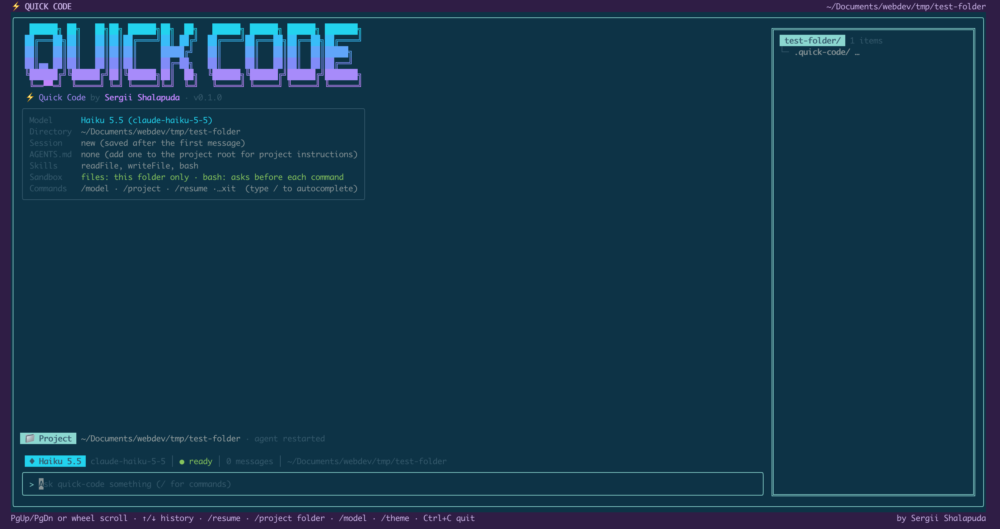
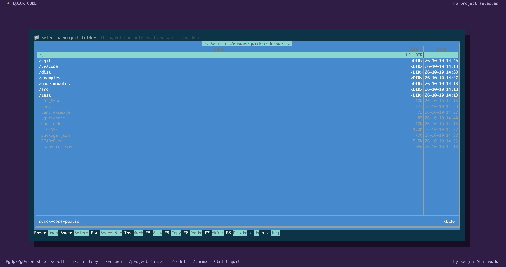

# quick-code

A small terminal coding agent. It reads and writes files **only inside the project folder you pick**
and runs shell commands there **only after you approve each one**. Built with Bun, Ink and the
Anthropic SDK.

> **Example project, not production software.** It was built as a learning exercise with the help of
> AI tools. It has not been security-audited and has no prompt-injection defenses or command
> classifier. Review and harden it before using it for anything beyond experiments.
> Licensed under [MIT](LICENSE); provided as is, without warranty.



## Quick start

Requires [Bun](https://bun.sh) and an Anthropic API key.

```sh
bun install
cp .env.example .env        # then put your key in .env, or export ANTHROPIC_API_KEY
bun start                   # bun run src/index.tsx
```

Build a standalone binary with `bun run build` (output: `dist/quick-code`).
Run the tests with `bun test` and `bun run typecheck`.

The [`examples/`](examples) folder holds two small projects the agent generated while testing.

## How it works

On start a Norton Commander style navigator opens in the launch directory. Pick a folder with
Space; the agent restarts confined to it and resumes that project's latest session. A live file
tree appears on the right when the terminal is at least 90 columns wide.

| Key (navigator) | Effect |
| --- | --- |
| ↑/↓, PgUp/PgDn, Home/End | Move |
| Enter / → , ← / Backspace | Open folder, go up |
| Space | Use the highlighted folder as the project |
| F3 | Quick view of a file (read-only, hex for binary) |
| F7 | Create a folder |
| Ins, F5, F6 | Mark, copy, paste (never overwrites) |
| F8 | Delete after confirmation (no trash) |



F-keys have Ctrl alternatives (see the key bar at the bottom of the navigator).

| Chat command | Effect |
| --- | --- |
| `/model [name]` | Pick a model, or switch directly: `haiku`, `sonnet`, `opus` or a `claude-*` id |
| `/project [path]` | Open the navigator, or switch folder directly |
| `/resume [id]` | List saved sessions, or resume one |
| `/clear` | Start a new conversation (the old one stays saved) |
| `/theme` | Reload `.quick-code/theme.json`, creating it from the defaults if missing |
| `/exit`, Ctrl+C | Quit |

Type `/` for autocomplete. ↑/↓ in the input box walk through previous prompts.

## Configuration

| Variable | Effect |
| --- | --- |
| `ANTHROPIC_API_KEY` | Required. Read from the environment or a `.env` in the current directory |
| `QUICK_CODE_MODEL` | Startup model (alias or full id); default is Haiku 5.5 |
| `QUICK_CODE_MOUSE=0` | Leave the mouse to the terminal (wheel scrolling is off, text selection works) |

Models are listed in `src/llm/models.ts`.

### Project data

Selecting a project creates `<project>/.quick-code/` with a `.gitignore` of `*`, so none of it is
committed by accident:

| File | Contents |
| --- | --- |
| `sessions/` | One JSON file per conversation, plus an index (rebuilt if missing or corrupt) |
| `commands-history.md` | Last 50 submitted inputs |
| `theme.json` | Optional color overrides |

Session files hold the exact model context, including file contents and command output, so treat
them as sensitive. If the project root has an `AGENTS.md`, it is added to the system prompt
(first 40,000 characters, re-read on every message).

### Theme

All colors live in [`src/ui/theme.json`](src/ui/theme.json). Override any of them per project in
`.quick-code/theme.json`; unlisted colors keep their defaults:

```json
{ "chat": { "agentText": "#ffd580" }, "page": { "bg": "#1e1e2e" } }
```

Accepted values: ANSI names, `#rgb`/`#rrggbb`, `rgb(r, g, b)`, `ansi256(n)` or `default`.

## Safety model

- **Paths.** `readFile` and `writeFile` resolve every path through `resolveSafePath`
  (`src/skills/pathGuard.ts`). It rejects empty and NUL-containing paths, then requires both the
  lexical and the symlink-resolved path to be inside the project. Only the user can change the
  project folder. See `test/skills.test.ts` for the covered escape cases.
- **Shell.** A shell cannot be path-confined, so `bash` relies on approval. Each command is shown
  verbatim and runs only after `y` (once) or `a` (until the next project switch). It runs with
  `/bin/bash -c` in the project folder, no stdin, a 30 s default timeout (max 120 s, kills the
  process group) and output capped at 30k characters. Variables whose names contain `KEY`,
  `TOKEN`, `SECRET`, `PASSWORD` or `CREDENTIAL` are removed from the command's environment.
- **Terminal.** The file viewer shows control characters as `·`, so a file cannot inject escape
  sequences.

Known limits: an approved command can do anything your user can, `a` ("always") approves all
later commands, and file contents sent to the model can contain prompt injections.

## Layout

| Path | Role |
| --- | --- |
| `src/index.tsx` | Entry point: environment, adapter, skills, Ink render |
| `src/agent/` | `AgentService` (input → LLM → tool calls → answer) and `AGENTS.md` loading |
| `src/llm/` | Provider-neutral `ILlmAdapter` types, Anthropic implementation, model list |
| `src/skills/` | `Skill` interface and registry, `readFile`, `writeFile`, `bash`, `pathGuard` |
| `src/project/` | Directory listing and tree, file viewing, guarded copy and delete |
| `src/session/` | `.quick-code` folder, session store, command history |
| `src/ui/` | Ink components, theme, mouse and function-key handling |
| `src/shims/` | No-op `react-devtools-core` so `bun build --compile` can bundle Ink |
| `test/` | Unit tests (`bun test`) |
| `docs/img/` | Screenshots used in this README |
| `examples/` | Sample projects created with the agent |
